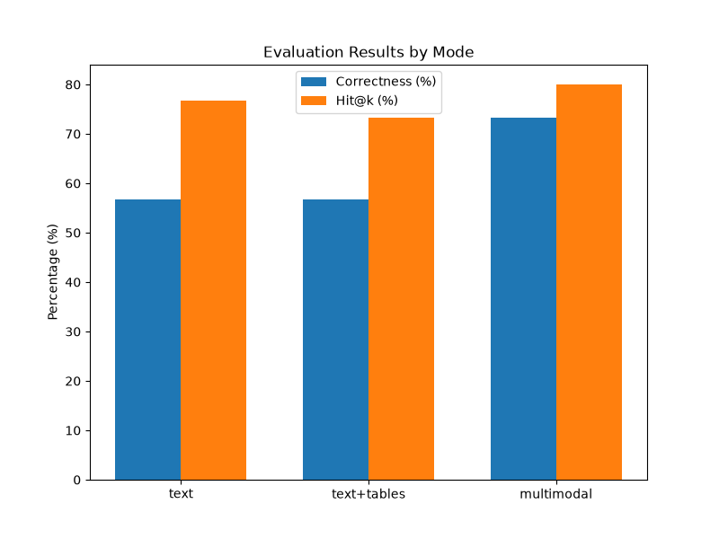

# Multimodal RAG: Retrieval-Augmented Generation over Text, Tables and Images

**Student:** Anusha Jain (C219) · NLP Mini Project

A RAG system that parses PDFs into text chunks, tables (as markdown) and images; embeds text/tables with a sentence-transformer and images with CLIP; retrieves across all three modalities; and gives the evidence (text **and** images) to a vision-capable LLM (Gemini) that returns a **grounded answer with source document and page citations**, or says the answer is not in the documents.

**Core technical idea:** CLIP embeds text and images into the **same vector space**, so a text query can be matched directly to images without captioning.

---

## Architecture

```text
PDFs ──► ingest.py ──► text chunks ─┐
                       tables (md) ─┼─► bge-small ──► FAISS text index  (type: text | table)
                       images ──────┴─► CLIP image ─► FAISS image index
                                                           │
question ──► retriever.py ─► top-k text/tables  +  top-k images (CLIP text->image)
                              + images on the same doc+page as the top text/table hits
                              + evidence gate ("insufficient evidence" -> no LLM call)
                                      │
                                      ▼
                  generator.py ─► Gemini (labelled text + images, JSON out, temp 0)
                                      │  {answer, answer_found, citations[ids]}
                                      ▼
                  app.py (FastAPI) ─► static/index.html
```

### Three Retrieval Modes (the experiment)

| Mode | Evidence Used | Represents |
|---|---|---|
| `text` | Plain text chunks only | Standard text-only RAG (Baseline A) |
| `text+tables` | Text + structured markdown tables | Ablation (B) |
| `multimodal` | Text + tables + images (images sent to Gemini) | The proposed system (C) |

---

## Setup (Windows)

1. Clone the repository:
   ```powershell
   git clone https://github.com/aj-dgaf/Multimodal-RAG.git
   cd Multimodal-RAG
   ```

2. Create and activate virtual environment:
   ```powershell
   py -3.11 -m venv .venv
   .venv\Scripts\Activate.ps1
   python -m pip install --upgrade pip
   ```

3. Install requirements:
   ```powershell
   pip install -r requirements.txt
   ```

4. Copy `.env.example` to `.env` and add your Gemini API key:
   ```powershell
   copy .env.example .env
   # Edit .env and replace your_key_here with your actual key
   ```

5. Download the 12 PDFs listed in the Corpus table below into `data/pdfs/`.

---

## Run Steps

1. **Build the indexes** (text + image FAISS indexes from the PDFs):
   ```powershell
   python ingest.py
   ```

2. **Test from CLI** (optional):
   ```powershell
   python generator.py "What is the standalone revenue for Infosys?" --mode multimodal
   ```

3. **Start the web server:**
   ```powershell
   uvicorn app:app --reload
   ```

4. Open your browser at `http://127.0.0.1:8000`.

5. **Run evaluation** (after populating `data/eval_questions.json`):
   ```powershell
   python evaluate.py
   ```

---

## Corpus

> **Note:** PDFs are not committed to the repository (copyrighted). Download them from the URLs below and place in `data/pdfs/`.

| # | Filename | Title | Publisher | URL / Source | Pages |
|---|---|---|---|---|---|
| 1 | `infosys-ar-26.pdf` | Infosys Integrated Annual Report 2025-26 | Infosys Limited | [infosys.com](https://www.infosys.com/investors/reports-filings/annual-report.html) | 383 |
| 2 | `AnnualReportFY26.pdf` | 2nd Integrated Annual Report 2025-26 | Tata Motors Limited | [tatamotors.com](https://www.tatamotors.com/investors/annual-reports/) | 488 |
| 3 | `annual-report-2025-26.pdf` | Annual Report 2025-26 | Hindustan Unilever Limited | [hul.co.in](https://www.hul.co.in/investor-relations/annual-reports/) | 244 |
| 4 | `financial-results-for-the-quarter-ended-june-30-2026.pdf` | Unaudited Financial Results Q1 FY27 | HDFC Bank Limited | [hdfcbank.com](https://www.hdfcbank.com/personal/resources/investor-relations) | 16 |
| 5 | `CELERIO_Owners-Manual.pdf` | Celerio Owner's Manual | Maruti Suzuki India | [marutisuzuki.com](https://www.marutisuzuki.com/owners/owners-manual) | 279 |
| 6 | `maestroedge2.pdf` | Maestro Edge Owner's Manual | Hero MotoCorp | [heromotocorp.com](https://www.heromotocorp.com/en-in/reach-us/owners-manual.html) | 95 |
| 7 | `RDC215DBWRX.pdf` | Direct Cool Refrigerator Manual | Samsung Electronics | [samsung.com](https://www.samsung.com/in/support/) | 21 |
| 8 | `c05633409.pdf` | HP Notebook / Computer User Guide | HP Inc. | [hp.com](https://support.hp.com/) | 70 |
| 9 | `lebo101.pdf` | Biology (Class 12, Flowering Plants) | NCERT | [ncert.nic.in](https://ncert.nic.in/textbook.php) | 25 |
| 10 | `eeev104.pdf` | Environmental Studies (Green School) | NCERT | [ncert.nic.in](https://ncert.nic.in/textbook.php) | 18 |
| 11 | `jesc109.pdf` | Science (Class 10, Light Reflection) | NCERT | [ncert.nic.in](https://ncert.nic.in/textbook.php) | 27 |
| 12 | `kest105.pdf` | Statistics for Economics (Class 11) | NCERT | [ncert.nic.in](https://ncert.nic.in/textbook.php) | 16 |
| **Total** | **12 documents** | | | | **1,682 pages** |

---

## Results

Evaluation across 35 benchmark questions (10 text-focused, 10 table-focused, 10 figure/image-focused, and 5 unanswerable out-of-domain queries) across the three retrieval modes:

| Mode | Hit@k (Page) | Correctness | False Abstain | True Abstain | Faithfulness | Relevancy | Avg Latency |
|---|---|---|---|---|---|---|---|
| `text` (Baseline A) | 76.7% | 56.7% | 9 | 100.0% | 70.0% | 70.0% | 2,111 ms |
| `text+tables` (Ablation B) | 73.3% | 56.7% | 6 | 100.0% | **80.0%** | 80.0% | 1,344 ms |
| `multimodal` (Proposed C) | **80.0%** | **73.3%** | **4** | 100.0% | 73.3% | **83.3%** | 4,675 ms |

Correct answers by question type (out of 10 each):

| Mode | Text questions | Table questions | Figure questions |
|---|---|---|---|
| `text` | 7 | 6 | 4 |
| `text+tables` | 7 | 7 | 3 |
| `multimodal` | 7 | **9** | **6** |

> **How to read these numbers:** Answers and judge verdicts both come from `gemini-3.5-flash-lite` (free tier, paced at one call every 5 seconds to stay under 15 requests/minute). All 105 question/mode runs completed with no failed answer calls. Hit@k, Correctness, Faithfulness and Relevancy are percentages of the 30 answerable questions; False Abstain is a count out of 30; True Abstain is the share of the 5 unanswerable questions. An abstained answer scores 0 on Faithfulness and Relevancy. Faithfulness and Relevancy are single yes/no verdicts from a Gemini judge prompt in the style of RAGAS, not the RAGAS library. With 10 questions per type, a difference of one or two questions is not significant.



### Key Takeaways
1. **Multimodal answers the most questions correctly (73.3% vs 56.7%).** The gain comes from table questions (9 of 10 vs 6 for text-only) and figure questions (6 of 10 vs 4); text questions are identical across modes (7 of 10).
2. **Multimodal abstains wrongly less often.** It said "not found" on 4 answerable questions, against 9 for text-only and 6 for text+tables.
3. **All 5 unanswerable questions were refused in every mode.** These refusals came from Gemini following the evidence-only prompt. The retriever's evidence gate never triggered in this run (the score thresholds in `config.py` are still placeholders), so it saved no API calls.
4. **Retrieval differences are small.** Page Hit@k is 23, 22 and 24 of 30 for the three modes.
5. **Multimodal is slower.** Sending images roughly doubles to triples the average response time.

---

## Concrete Failure Cases

1. **Dense text-heavy chart retrieval**
   - **Question:** "What does the line chart on page 14 indicate?"
   - **Retrieved:** Unrelated charts from similar pages.
   - **Why it failed:** CLIP text-to-image embeddings struggle with dense, text-heavy charts where the visual content is mostly numbers and labels.
   - **Fix:** Generate textual captions for all images during ingestion (image-to-text captioning) before embedding.

2. **Unanswerable question still retrieves evidence**
   - **Question:** "What is the capital of Mars?"
   - **Retrieved:** A tangential image of a globe/map.
   - **Why it failed:** FAISS IP search always returns the nearest vectors even when nothing is relevant. The evidence gate caught this (answer_found = false), but the retriever still pulled in low-relevance images.
   - **Fix:** Stricter score thresholding specifically for CLIP embeddings.

3. **Complex multi-level table parsing**
   - **Question:** "Summarize the revenue breakdown table on page 33."
   - **Retrieved:** A garbled text chunk instead of a structured markdown table.
   - **Why it failed:** PyMuPDF's heuristic table extraction failed on a complex multi-level header table, flattening it into a text blob.
   - **Fix:** Use a specialized vision-based table extraction model (like Table Transformer).

---

## Limitations and Future Work

**Limitations:**
- CLIP is weaker on dense charts and text-heavy diagrams (mitigated by page-linking).
- Scanned PDFs are not supported (no OCR).
- Tiny text inside images may be misread by the vision model.

**Future Work:**
- Hybrid search (BM25 + dense retrieval).
- Specialized table extraction pipeline (Table Transformer).
- Replace CLIP with a multimodal embedding model fine-tuned for document charts (e.g. ColPali).
- Add OCR support for scanned PDFs.

---

## Website Screenshots

*(Add screenshots of the web UI here)*

---

## Credits

Fonts: SS Default Lingo (Typocracy Studio), Astrid Grotesk (Schizotype / Eclectotype).
